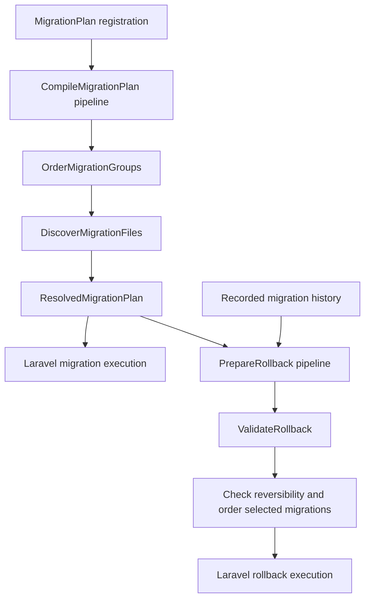

# Migration plan architecture

The package separates declaring ownership, compiling an execution plan, validating rollback, and executing Laravel migrations. Laravel remains responsible for migration events, SQL execution, history writes, and database transaction behavior.

## Responsibilities

`MigrationPlan` preserves the public registration and array APIs. It stores `MigrationGroup` values, delegates compilation, and owns the active operation's snapshot.

`CompileMigrationPlan` uses Laravel's `Pipeline` with typed private stage methods. It orders and validates the dependency graph, then canonicalizes declared paths and discovers files. `MigrationPlanDefinition` carries intermediate values; the output is a `ResolvedMigrationPlan`.

`OrderMigrationGroups` performs deterministic depth-first traversal. Separate visited and active-path sets prevent repeated visits and identify cycles. `DiscoverMigrationFiles` handles direct-child discovery, exclusions, duplicate names, and ordering within an owner. `MigrationPaths` centralizes canonicalization and explicit path ownership.

`PrepareRollback` validates a `RollbackPlan` before resolving selected migration instances. `ValidateRollback` checks all recorded migrations are available, confirms selected migrations have run, computes transitive owner prerequisites, and rejects retained dependents or later executions within the same owner. Preparation then checks every selected migration's reversibility and sorts by reverse owner order followed by reverse execution order.

`OrderedMigrator` adapts those results to Laravel's migrator hooks. `OrderedMigrationRepository` reads history by row `id`, preserving execution order even when timestamps disagree with dependencies.

`ValidatePrerequisites` checks recorded applications before each real `up()` attempt. Both forward and rollback validation use `ResolvedMigrationPlan::dependencies()` for transitive owner relationships. Laravel still owns skip evaluation, execution, and history writes; a skipped prerequisite cannot silently permit a dependent to run. Pretend mode retains Laravel's simulation semantics.

Rollback preparation resolves every selected migration and validates that `down()` is public, needs no arguments, and is not declared `never` before executing any selection.

## Operation lifetime

The shared command trait rejects unsupported options and schema dumps, opens an operation scope, and validates effective paths, including Laravel's implicit application migration directory. Only then does it delegate to Laravel's command execution. This places ownership validation before repository creation, reset, or `db:wipe`.

Nested commands in `fresh` and `refresh`, and their nested migrator calls, share the outer snapshot. Direct migrator calls also open a scope. The outermost scope clears its snapshot on success or failure, so subsequent operations can discover newly added files.

The inspection commands reuse command preflight and the resolved snapshot. They render either tables or a versioned JSON document without querying migration history or loading migration PHP files.

The snapshot freezes declarations and discovered file metadata for an operation. It does not lock the filesystem or preserve migration file contents. Deploy immutable migration files and register ownership before execution. Registration is rejected while a snapshot is active.

## Extension and testing boundaries

The three existing host adapter classes remain nonfinal. Other implementation classes are final; data classes are also readonly. Architecture tests enforce immutability and prevent domain actions from depending on command or database execution.

Unit tests exercise graph ordering, forward/rollback policy, and resolution lifetime without a database. Integration tests execute real migrations against SQLite, PostgreSQL, and MySQL. Feature tests exercise provider bindings and actual Artisan commands, including validation before destructive work, inspection, pretend mode, and database connection routing.

Pipelines use explicitly supplied collaborators and callables, so their core behavior does not need a booted service container. Stages are fixed package internals rather than configurable hooks that could bypass required validation.
